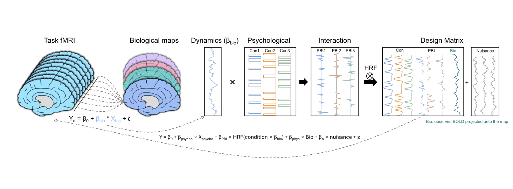

# Psychobiological Interaction (PBI)

English · [简体中文](README.zh-CN.md)

PBI uses a biological map to define a distributed fMRI component and asks **where coupling with that component changes across task conditions**. The map describes how a biological feature varies across brain locations. Examples include a PET receptor or transporter map, a regional gene-expression map derived from the [Allen Human Brain Atlas](https://human.brain-map.org/), or a structural map such as regional cortical thickness. Each subject's task fMRI supplies the time-varying signal.

The current MATLAB/SPM12 implementation fits a single-run generalized psychophysiological interaction (gPPI) model with one volume-defined component and volume, GIFTI or CIFTI targets. We have tested component extraction with PET templates. Gene-expression and structural maps are candidate inputs that require appropriate spatial coverage, registration and validation.

## How PBI works



**Figure 1.** The same fixed biological map supplies spatial weights for two time series. The physiological main effect enters the target model at scan resolution. The deconvolved time series is multiplied by each centered condition at microtime resolution, convolved with the hemodynamic response function (HRF), then sampled at scan times. [Editable PowerPoint figure](docs/figures/pbi-workflow.pptx)

1. **Estimate expression of the map.** At each scan, regress the spatial pattern of observed BOLD on the map values and an intercept within the extraction mask. The slope is the subject's expression of that spatial pattern at that scan. Its mean-centered time series $\mathrm{Bio}$ is the physiological main effect (`seed_phys_bold` in SPM).
2. **Build the interactions.** Use the source task GLM to adjust BOLD for effects outside the task effects of interest. Project the adjusted data onto the same map and estimate the latent component time series $\beta_{\mathrm{bio}}(\tau)$ on the microtime grid with SPM's `spm_PEB`. The shared temporal model and fixed covariances allow one deconvolution per map. Multiplying this time series by each centered condition before HRF convolution gives one interaction regressor per condition.
3. **Fit the target BOLD signal.** The equation shows the terms for one condition at one target location. The full model includes a task column and a PBI column for each condition, one Bio main-effect column, and the nuisance regressors.

$$
Y = \beta_0 + \beta_{\mathrm{psycho}} \times X_{\mathrm{psycho}} + \beta_{\mathrm{PBI}} \times \mathrm{HRF}(\mathrm{condition} \times \beta_{\mathrm{bio}}) + \beta_{\mathrm{phys}} \times \mathrm{Bio} + \beta_n \times \mathrm{nuisance} + \varepsilon.
$$

$X_{\mathrm{psycho}}$ is the HRF-convolved task regressor. Inside the interaction, `condition` is the centered task vector before convolution. HRF(·) means convolve the product and sample it at scan times. $\mathrm{Bio}$ denotes the mean-centered projection of observed BOLD onto the map. Its coefficient accounts for coupling shared across conditions.

For a monetary incentive delay (MID) task, $\beta_{\mathrm{PBI,big}}-\beta_{\mathrm{PBI,no}}>0$ means the estimated coupling slope at that location is higher during big-win anticipation than during no-win anticipation. The biological label identifies the spatial reference for the fMRI component. For example, a 5-HT1A-informed contrast estimates a difference in functional coupling. Establishing a change in serotonin release would require an independent measurement. A separate planned analysis will test whether task conditions predict the scan-level component $\mathrm{Bio}$ itself.

## Quick start with MATLAB

**1. Prepare the inputs.** Put SPM12 and the repository's `matlab` folder on the MATLAB path. Use a single preprocessed 4D BOLD run, a binary gray-matter mask, and one biological template on the same voxel grid. The current extraction mask intersects the source GLM mask, gray matter and finite template values **greater than `1e-8`**. This matters for signed gene-expression scores or structural maps with meaningful zero values: the current implementation would drop those locations. Surface-only maps also require a workflow that defines their sampling on the source BOLD grid.

**2. Estimate the task model once.** The example illustrates two anticipation conditions. Replace the example onsets with the subject's events, include all modeled task phases, and supply confounds with one row per scan. Onsets, durations and TR are in seconds. If you already have a compatible estimated `SPM.mat`, use its path as `spmFile` and continue at step 3.

```matlab
addpath('/path/to/spm12', '/path/to/PBI/matlab');
conditions = struct('name', {'no_win', 'big_win'}, ...
    'onset', {[10 42 74], [26 58 90]}, 'duration', {4, 4});
spmFile = pbi.task_glm('bold.nii.gz', conditions, 2.2, 'task_model', ...
    Confounds=readmatrix('motion.tsv', 'FileType', 'text'));
```

**3. Fit PBI and inspect the contrast.** Choose a fresh output directory for each template. Condition names match the source design exactly, so the same contrast works when condition order changes.

```matlab
bigVsNo = struct('name', 'anticipation_big-no', ...
    'positive', 'big_win', 'negative', 'no_win');
result = pbi.fit(spmFile, '5HT1A_template.nii', 'gm_mask.nii', ...
    'pbi_5HT1A', Contrasts=bigVsNo);
```

For a volume target, open `pbi_5HT1A/con_0001.nii` for the coupling difference and `spmT_0001.nii` for its T statistic. Inspect `result.phys` and `seed_mask.nii` for the Bio time series and its spatial coverage, and the output `SPM.mat` for the design. An existing source GLM needs one unmodulated canonical HRF regressor per condition and an F contrast covering the task effects of interest in the first contrast slot. The API guide includes examples for paired GIFTI and mixed CIFTI targets. [MATLAB API guide](matlab/README.md)

## Resources and related work

The [method specification](docs/methods.md) describes the model and validation targets. The [PET resource catalog](resources/pet/) records template space and coverage. A standalone Python implementation and visualization modules are planned.

PBI draws on [REACT](https://doi.org/10.1016/j.neuroimage.2019.04.007) for spatially informed fMRI components and [gPPI](https://doi.org/10.1016/j.neuroimage.2012.03.068) for condition-specific coupling. Related molecularly informed task-fMRI applications include [Wong et al. (2022)](https://doi.org/10.1177/02698811221092509) and [Boucherie et al. (2023)](https://doi.org/10.1177/02698811231211154).
