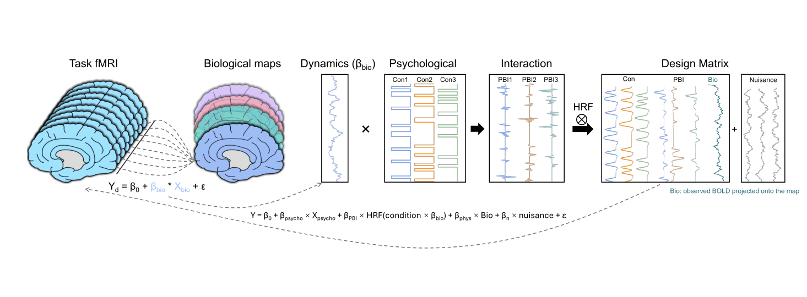

# 心理–生物交互分析（PBI）

[English](README.md) · 简体中文

PBI 用一张生物学图谱定义分布式 fMRI 成分，研究**哪些脑区与该成分的耦合随任务条件而改变**。图谱描述某个生物学特征在不同脑区的空间分布，例如 PET 受体或转运体图谱、由[艾伦人脑图谱（AHBA）](https://human.brain-map.org/)构建的区域基因表达图谱，或区域皮层厚度等结构图谱。随时间变化的信号来自每位被试自己的任务 fMRI。

当前 MATLAB/SPM12 实现支持单个 run 的广义心理生理交互（gPPI）分析。每次拟合在体积空间定义一个图谱成分，目标数据可以是体积 BOLD、GIFTI 或 CIFTI。我们用 PET 模板验证了成分提取流程；对基因表达或结构图谱，还需针对其空间覆盖、配准和生物学含义分别验证。

## 方法原理



**图 1.** 同一张固定图谱为两条时间序列提供空间权重。生理主效应以扫描时间分辨率进入目标模型。另一条序列经去卷积后，在微时间网格上与各中心化条件相乘，再与血流动力学响应函数（HRF）卷积并采样到扫描时点。 [可编辑的 PowerPoint 原图](docs/figures/pbi-workflow.pptx)

1. **估计图谱模式的表达。** 在提取掩膜内，对每一帧观测 BOLD 的空间分布做回归，自变量为各位置的图谱值，模型含截距。斜率表示该被试这一帧对图谱空间模式的表达程度。斜率序列经时间均值中心化后得到生理主效应 $\mathrm{Bio}$，在 SPM 中名为 `Bio`。
2. **构建交互项。** 利用源任务 GLM 调整 BOLD，保留感兴趣的任务效应。用同一组图谱权重投影校正后的信号，再以 SPM 的 `spm_PEB` 在微时间网格上估计潜在的成分时间序列 $\beta_{\mathrm{bio}}(\tau)$，保存在 `result.beta_bio_microtime` 中。由于各位置共享时间模型和固定协方差，每张图谱只需去卷积一次。将该时间序列分别与各中心化条件相乘，经 HRF 卷积后为每个条件生成一个交互回归量。
3. **拟合目标 BOLD。** 下式以一个目标位置、一个任务条件为例。实际模型为每个条件各设一列任务主效应和一列 PBI 交互项，所有条件共用一列 Bio 主效应，并纳入混杂回归量。

$$
Y = \beta_0 + \beta_{\mathrm{psycho}} \times X_{\mathrm{psycho}} + \beta_{\mathrm{PBI}} \times \mathrm{HRF}(\mathrm{condition} \times \beta_{\mathrm{bio}}) + \beta_{\mathrm{phys}} \times \mathrm{Bio} + \beta_n \times \mathrm{nuisance} + \varepsilon.
$$

$X_{\mathrm{psycho}}$ 是经 HRF 卷积后的任务回归量。交互项中的 `condition` 是卷积前已中心化的任务向量。HRF(·) 表示将括号内的乘积与 HRF 卷积，再采样到扫描时点。$\mathrm{Bio}$ 是观测 BOLD 在图谱上的投影经时间均值中心化后得到的序列，其系数用于估计各条件共有的耦合。

以金钱激励延迟（MID）任务为例，$\beta_{\mathrm{PBI,big}}-\beta_{\mathrm{PBI,no}}>0$ 表示在预期大奖时，该位置与图谱定义的 fMRI 成分之间的耦合斜率高于预期无奖时。若使用 5-HT1A 图谱，这个结果反映的是以该受体分布为参照的功能耦合差异。要判断血清素释放是否变化，还需要独立测量。任务条件能否预测 $\mathrm{Bio}$ 本身是另一个问题，相关分析目前处于规划阶段。

## MATLAB 快速入门

**1. 准备输入。** 将 SPM12 和本仓库的 `matlab` 目录加入 MATLAB 路径。准备单个 run 的四维 BOLD、二值灰质掩膜，以及与 BOLD 体素网格一致的一张生物学模板。当前成分的提取范围取源 GLM 掩膜、灰质掩膜及模板有效范围的交集，只保留模板值有限且 **大于 `1e-8`** 的位置。因此，输入有正负值的基因表达分数或零值有实际意义的结构图谱时，这些非正位置会被排除。只有表面数据的模板也需要先确定如何在源 BOLD 的体素网格上采样。

**2. 每个 run 估计一次任务模型。** 下面用两个预期条件演示。实际分析请换成该被试的事件时序，纳入需要建模的全部任务阶段；混杂矩阵每行对应一帧。事件起始时间、持续时间和 TR 均以秒计。已有符合要求的一阶模型时，可直接把其 `SPM.mat` 路径赋给 `spmFile`，从第 3 步开始。

```matlab
addpath('/path/to/spm12', '/path/to/PBI/matlab');
conditions = struct('name', {'no_win', 'big_win'}, ...
    'onset', {[10 42 74], [26 58 90]}, 'duration', {4, 4});
spmFile = pbi.task_glm('bold.nii.gz', conditions, 2.2, 'task_model', ...
    Confounds=readmatrix('motion.tsv', 'FileType', 'text'));
```

**3. 拟合 PBI 并查看对比。** 每张模板使用一个新的输出目录。按源模型中的条件名指定对比，调整条件顺序后仍可复用。

```matlab
bigVsNo = struct('name', 'anticipation_big-no', ...
    'positive', 'big_win', 'negative', 'no_win');
result = pbi.fit(spmFile, '5HT1A_template.nii', 'gm_mask.nii', ...
    'pbi_5HT1A', Contrasts=bigVsNo);
```

对于体积目标，`pbi_5HT1A/con_0001.nii` 是耦合差异的效应图，`spmT_0001.nii` 是对应的 T 图。用 `result.Bio` 和 `bio_mask.nii` 核对 Bio 时间序列及提取范围，用输出的 `SPM.mat` 查看设计矩阵。如果直接使用已有源模型，每个条件应有一个无调制的标准 HRF 回归量，首个对比应为覆盖感兴趣任务效应的 F 对比。左右半球 GIFTI 和混合 CIFTI 的调用示例见 [MATLAB API 指南](matlab/README.md)。

## 资源与相关研究

[方法说明](docs/methods.md)记录了模型及验证目标，[PET 资源目录](resources/pet/)列出了模板空间和覆盖范围。独立 Python 实现与可视化模块尚在规划中。

PBI 借鉴 [REACT](https://doi.org/10.1016/j.neuroimage.2019.04.007) 提取空间图谱引导的 fMRI 成分，并采用 [gPPI](https://doi.org/10.1016/j.neuroimage.2012.03.068) 估计条件特异性耦合。分子图谱引导的任务 fMRI 应用可参见 [Wong 等（2022）](https://doi.org/10.1177/02698811221092509)与 [Boucherie 等（2023）](https://doi.org/10.1177/02698811231211154)。
